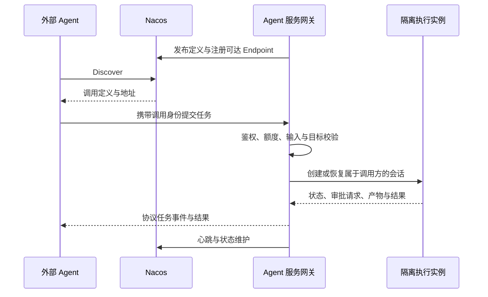

<!--
  Copyright 1999-2026 Alibaba Group Holding Ltd.

  Licensed under the Apache License, Version 2.0 (the "License");
  you may not use this file except in compliance with the License.
  You may obtain a copy of the License at

       http://www.apache.org/licenses/LICENSE-2.0

  Unless required by applicable law or agreed to in writing, software
  distributed under the License is distributed on an "AS IS" BASIS,
  WITHOUT WARRANTIES OR CONDITIONS OF ANY KIND, either express or implied.
  See the License for the specific language governing permissions and
  limitations under the License.
-->

# Agent 互联规范

本文约束 F08、F09，分别定义消费远端 Agent、登记已有服务，以及将本地 Agent 执行能力
服务化的行为。Nacos 负责发现元信息，调用协议和任务执行由调用适配器及服务网关实现。

## 1. 三类事实

| 对象 | 所表达的事实 | 所有者 |
| --- | --- | --- |
| Agent 定义与版本 | 名称、用途、调用协议、descriptor 和版本。 | Nacos AI Resource 管理面。 |
| Runtime Endpoint | 某个活跃发布者当前提供的服务地址。 | 实际服务进程或被明确授权的发布者。 |
| 调用任务 | 输入、执行会话、事件、结果和取消状态。 | Agent 服务与调用适配器。 |

创建 Agent 定义不会启动服务；注册地址不会创建执行入口。发现成功也不证明请求已被远端
授权或已执行。AgentSpec 装配为服务提供模板输入，但本身不是运行中的 Agent。

## 2. 远端 Agent 消费

1. 根据业务意图查询可见目录并选择 Agent 引用。
2. 通过 RAD Discover 取得目标版本的调用快照，检查协议、transport、版本与可用地址。
3. 根据受支持的调用协议和用户授权解析目标服务凭据，不复用 Nacos token。
4. 在发出请求前展示必要的输入与数据发送范围；已有任务授权覆盖时直接继续。
5. 调用并映射任务 ID、进度、结果、失败和取消；能力不支持时明确返回限制。

调用适配器必须按声明的协议解释 descriptor，不能仅凭一个 URL 假设它符合 A2A。
A2A 是候选的具体调用适配，所支持的协议版本和流式/取消能力必须进入兼容矩阵。
其他协议通过独立适配器扩展，不修改统一的资源身份。

Watch 变化后重新 Discover，更新的是后续调用使用的快照。在途任务继续绑定原任务端点，
不得因发现变化向另一个实例自动重发可能有副作用的请求。连接中断后只有远端协议提供
幂等或恢复能力时才能恢复；无法判断是否执行的请求标记为结果未知。

## 3. 登记已有远端服务

具有管理权限的使用者可以为真实存在的服务创建或更新 Agent draft，并按 Nacos 生命周期
发布调用定义。已存在的静态地址与 Runtime Endpoint 使用各自支持的领域契约。
插件必须核对声明的协议与实际服务入口，不把当前聊天会话当作地址注册。

Runtime Endpoint 由服务或其授权代理维持活性。用户消费某个远端 Agent 时，不为该远端
服务伪造心跳。若插件进程被指定为发布者，必须明确其存活范围和关闭后地址失效的结果。

## 4. 本地 Agent 服务网关

网关为独立可部署组件，可以复用插件的 Nacos 接入与资源解析核心。插件负责配置和状态
入口，网关负责长期服务活性；安装插件不隐式开启对外端口。

| 责任 | 必须实现的边界 |
| --- | --- |
| 入站身份 | 验证调用方及允许的业务能力，不能以“来自注册中心”作为授权。 |
| 会话映射 | 将调用方、任务与执行会话绑定；不同身份不能任意恢复他人会话。 |
| 执行隔离 | 使用受控工作目录、凭据和工具策略，默认创建专用执行会话。 |
| 调度 | 限制并发、排队、超时与资源消耗，定义重启后任务可恢复范围。 |
| 审批 | 保留宿主审批语义；无人处理时返回等待输入或受控失败，不能自动绕过。 |
| 取消 | 转发到执行实例并跟踪终态；取消请求成功不等于已撤销此前外部副作用。 |
| 产物 | 定义可访问产物、身份校验和有效期，不将本地任意文件路径作为公开链接。 |
| 可观测 | 关联调用任务、执行会话、资源版本和操作 ID，日志不包含秘密。 |

## 5. Endpoint 活性与恢复

先启动并验证实际执行入口，再将可达地址注册到 Nacos。面向外部消费者的地址不能仅是
消费者不可达的 localhost。需要隧道或反向代理时，它属于显式部署配置。

HTTP 注册按照 Nacos 的 Publisher 身份和完整 Batch 语义实现，持久保存需要 redo 的期望
Publication。稳定 client ID、心跳、重连和注销共享明确的所有者；与 MCP Publication 共用
一个 HTTP Client 时，恢复必须覆盖所有归属该 Client 的期望 Publication。

停止接单后按协议处理在途任务，执行 best-effort 注销并依赖服务端过期兜底。进程恢复后
先核验运行入口，再恢复注册。注册成功、健康检查、业务调用成功分别记录。

## 6. 验收重点

消费侧覆盖协议不支持、无可用端点、下游拒绝、流式中断、结果未知与取消。
提供侧覆盖跨身份会话隔离、超时、审批等待、进程重启、心跳丢失、注销失败及不可达地址。
验收必须包含完整的“发现 -> 调用 -> 执行 -> 结果”，不能只验证注册中心中存在一条记录。

规范依据：[RAD](https://github.com/alibaba/nacos/blob/1511b5a85f744acb0ad54e8213b1f4d82674799c/specs/zh-cn/ai/rad-protocol-spec.md)、
[Agent 管理](https://github.com/alibaba/nacos/blob/1511b5a85f744acb0ad54e8213b1f4d82674799c/specs/zh-cn/ai/agent-management-spec.md)、
[Agent API](https://github.com/alibaba/nacos/blob/1511b5a85f744acb0ad54e8213b1f4d82674799c/specs/zh-cn/ai/agent-api-spec.md)。

各应用的执行 API 与会话映射在各自规范中定义，参见 [Codex 执行适配](../codex/specs/architecture-spec.md)。
