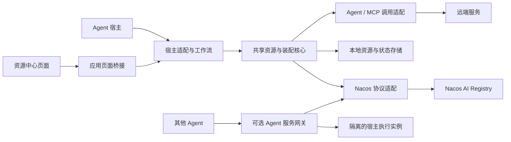

<!--
  Copyright 1999-2026 Alibaba Group Holding Ltd.

  Licensed under the Apache License, Version 2.0 (the "License");
  you may not use this file except in compliance with the License.
  You may obtain a copy of the License at

       http://www.apache.org/licenses/LICENSE-2.0

  Unless required by applicable law or agreed to in writing, software
  distributed under the License is distributed on an "AS IS" BASIS,
  WITHOUT WARRANTIES OR CONDITIONS OF ANY KIND, either express or implied.
  See the License for the specific language governing permissions and
  limitations under the License.
-->

# 架构与宿主适配规范

| 项目 | 值 |
| --- | --- |
| 状态 | 设计草案；本文中的“必须”约束拟实现行为，不表示已交付。 |
| 适用范围 | Coding agent 与 personal agent 的 Nacos 接入插件。 |
| 托管位置 | nacos-group/nacos-plugin 的 agent-plugins/，按 Agent 应用分目录。 |

## 1. 模块与依赖方向

| 模块 | 所有职责 | 不拥有的职责 |
| --- | --- | --- |
| 资源中心页面 | 已接入、发现资源、我的资源，以及设置、本地技能与操作结果展示。 | 自行访问凭据、执行命令或维护独立安装事实。 |
| 宿主适配与工作流 | 宿主工具入口、自然语言引导、资源加载和交互结果。 | Nacos 权限和生命周期规则。 |
| 共享核心 | 资源引用、依赖解析、变更计划、同步、冲突和操作记录。 | 某宿主的私有配置格式。 |
| Nacos 协议适配 | Client/Admin HTTP、认证、能力信息、分页及错误映射。 | 直接修改 Config、Naming 或数据库来模拟 AI API。 |
| 调用适配 | 选定协议的请求、流式事件、超时、取消和结果映射。 | 从发现结果推断调用权限或凭据。 |
| 本地状态存储 | 缓存、锁定版本、基线摘要、操作日志和恢复信息。 | 资源发布的服务端事实来源。 |
| 服务网关 | 对外调用入口、身份映射、隔离执行和 Endpoint 活性。 | 自动接管用户现有会话。 |

模块划分是逻辑边界，不要求每个模块成为独立服务或源码仓库。协议适配可使用经过验证的
SDK、CLI 或直接 HTTP 实现；核心不得依赖面向人的 CLI 文本输出。

页面内部进一步区分通用操作状态、应用能力适配和应用视觉适配。
[通用操作规范](resource-center-interaction-spec.md)约束入口、步骤、返回和执行结果；
各应用映射自己的桥接工具、主题与组件。共享核心不依赖某应用的 CSS 或页面 API，
更换主题不改变计划、权限和执行行为。该划分不要求立即建立共用前端库，实际复用时再按
已验证的能力提取代码；样式角色和适配记录见 [UI 规范](resource-center-ui-spec.md#11-视觉适配与可访问性)。

## 2. 资源身份与本地对象

远端身份为 `registryId + namespaceId + resourceType + resourceName`。
`registryId` 是本地连接配置的稳定引用，避免不同 Nacos 集群中的同名资源发生覆盖。
版本选择器与解析版本分开保存，不把 label 当作不可变版本。

| 逻辑对象 | 最小信息 |
| --- | --- |
| ResourceRef | 远端身份、可选版本或 label、目标宿主和作用域。 |
| ResolvedResource | 确切版本、内容摘要、可用状态、下载/调用描述及解析时间。 |
| AssemblyPlan | 输入引用、依赖图、目标变更、冲突、所需权限、基线摘要。 |
| InstallationRecord | 已应用版本、文件清单、内容摘要、宿主配置归属、依赖和加载状态。 |
| ManagementBinding | 本地来源、远端映射、上次上传/下载基线、同步方向与托管策略。 |
| LocalResourceCandidate / ReminderRecord | 盘点或变化候选、作用域、摘要、提示来源与用户选择。 |
| OperationRecord | 操作 ID、目标、阶段、结果、错误分类及恢复点。 |

上述名称是本插件的逻辑模型，不是对 Nacos HTTP DTO 或数据库 Schema 的新增要求。
本地持久格式必须带 schema version；迁移失败时保留原数据并停止相关写入。

## 3. 宿主能力契约

每个适配器必须声明并验证以下能力；未知能力不得按支持处理。

| 能力维度 | 必须说明的信息 |
| --- | --- |
| 执行位置 | 本机、远程工作区或云端；文件和网络调用实际发生在哪里。 |
| Skill | 支持的包格式、发现目录、作用域和刷新方式。 |
| Prompt | 任务输入或其他受支持的注入入口；变量与上下文容量限制。 |
| AgentSpec | 支持的模板 profile、字段映射、拒绝和部分支持规则。 |
| MCP | 支持的 transport、配置入口、认证和工具策略、刷新方式。 |
| 交互 | 工具调用、状态展示、确认与审批的宿主原生入口。 |
| 盘点与事件 | 可读取的资源列表/目录、初始化入口、Hook 事件覆盖与信任状态、提醒交付时机。 |
| 图形界面 | MCP Apps 资源、桥接调用、展示模式、全局/会话入口及策略限制，分别标记支持状态。 |
| 页面主题与控件 | 可用主题信号/变量、原生组件与后备样式；宽窄容器、焦点、浅深色及通用操作映射。 |
| 生命周期 | 启动、关闭、重连、进程所有权和持续后台执行能力。 |
| 服务化 | 是否具有稳定的会话创建、执行、事件和取消 API。 |

适配器不得通过复制某宿主的路径与配置语法声称支持另一个宿主。每个发布版本必须提供
宿主版本、操作系统、运行环境、Nacos 版本与能力的兼容矩阵。

## 4. 工具与状态表达

工具按连接诊断、资源搜索/读取、资源写入、计划/应用/恢复和远端调用分组。每个工具必须
定义参数、返回类型和实际副作用；不要暴露接受任意路径、任意 HTTP 或任意命令的通用入口。

耗时操作返回 operation ID 和阶段。界面至少区分：未连接、可读取、待授权、待装配、
已装配待加载、可使用、更新冲突、不可用、失败。用户可查看当前来源与版本。
诊断输出包含错误类型和可采取的下一步，不包含密码、token、完整 Prompt 或私有包内容。

## 5. 与现有 Nacos 规范的关系

本插件遵循[AI Registry 规范](https://github.com/alibaba/nacos/blob/1511b5a85f744acb0ad54e8213b1f4d82674799c/specs/zh-cn/ai/ai-registry-spec.md)、
[集成与适配器规范](https://github.com/alibaba/nacos/blob/1511b5a85f744acb0ad54e8213b1f4d82674799c/specs/zh-cn/integration/integration-adapter-spec.md)和
[HTTP API 规范](https://github.com/alibaba/nacos/blob/1511b5a85f744acb0ad54e8213b1f4d82674799c/specs/zh-cn/http-api/api-spec.md)。服务端契约优先于本插件内部便利模型。
既有 Nacos 规范无需因本插件的独立实现而改变；任何实际契约缺口必须列入
[待决策事项](TODO.md)，不能在插件中静默补造服务端语义。

## 6. 仓库与交付边界

仓库同时承载 Nacos Server 插件与 Agent 宿主插件。现有 `nacos-*-plugin-ext/` 和根 Maven
构建保留；Agent 插件不成为 Java 构建的强制依赖。通用规范维护在 `agent-plugins/specs/`；
各应用的实现、专属规范与构建入口维护在 `agent-plugins/<agent>/`，只有实际实现时才创建目录。
Agent 插件有独立依赖、测试、CI、版本和安装包，
同一源码构建自包含产物。用户资源、私有包、连接配置和凭据不进入仓库或发布包。

各应用适配独立声明版本与发布命名，采用 SemVer，并与服务端插件的 tag 规则区分。
分别记录 Nacos、Agent 应用和 OS/运行时兼容性；仅通过验证的组合可声明支持。
当前适配入口见 [Codex 专属规范](../codex/specs/README.md)，具体实现选择不作为通用技术栈要求。
