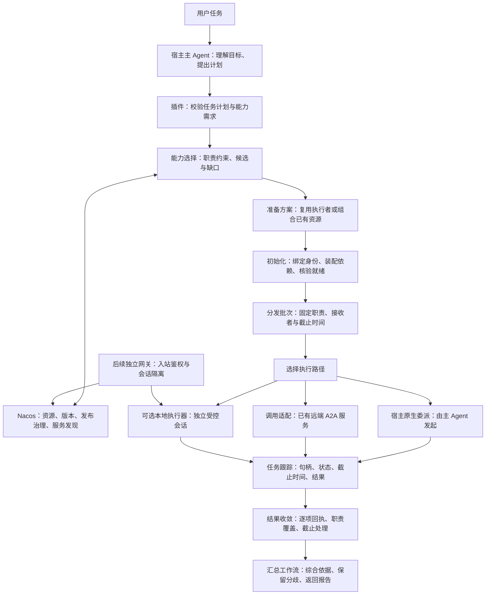
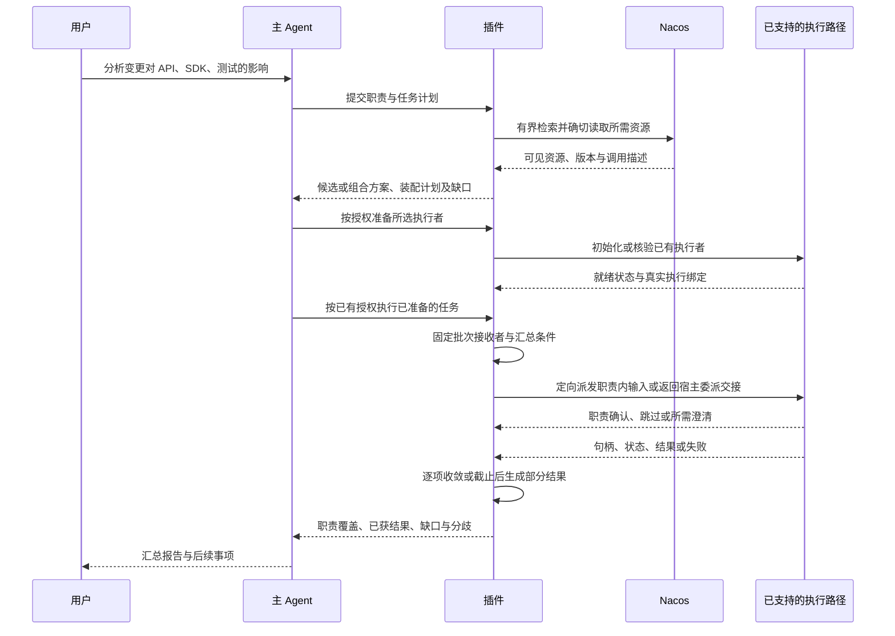

<!-- Copyright 2026 Alibaba Group Holding Ltd. SPDX-License-Identifier: Apache-2.0 -->

# 多 Agent 协作与职责分发规范

本文定义如何将能力发现、资源装配、任务执行和结果收集合成为按职责协作的工作流，当前为设计草案。
各小功能及其目标版本只在[全局路线图](roadmap.md)维护；本文说明模块如何组合，不另设一个总括所有工作的功能或排期。

## 1. 用户场景与范围

目标是把一项请求分配给职责互补的执行者：按能力要求找到候选，补齐可组合的能力，
统一准备执行环境，向选定对象分发职责内输入，再将各项结果收敛成报告。
编排、能力选择、实例准备、执行和汇总是可组合的职责，不要求各自部署一个专门 Agent。

首个组合场景是分析一次变更对 API、SDK 和测试的影响：主 Agent 提出 2–3 项职责，
使用已有能力或模板准备任务，分发到可用的执行路径，最后综合结果。
一个角色失败、超时或不适用时，仍返回其他结果和明确缺口。

资源兼容性检查、显式资源列表装配、单任务跟踪、手工任务列表的批量执行，以及结果收集都可以独立使用。
自动拆解和协作模板在这些能力上组合；首版不引入任意循环、动态任务图或多个执行者的自动代码写入合并。
多中心、认证、使用前更新和发布询问各自是独立产品功能。

## 2. 整体架构

这是逻辑模块图，不要求每个框成为独立 Agent、进程或服务。

| 层次 | 职责 |
| --- | --- |
| Nacos | 提供可复用资源的身份、版本、可见性、发布生命周期，以及真实服务的 Endpoint 发现。 |
| 主 Agent / 工作流 | 理解语义、提出职责和计划，调用可用的宿主委派入口，接收最终报告；沿用用户授权。 |
| 能力选择与分发 | 根据职责、输入输出与权限约束选择执行者，维护批次和交接；不承担被分派的业务分析或改写业务结论。 |
| 资源与实例准备 | 推荐资源、组合角色配置、锁定依赖、初始化和验证就绪；不代替执行角色处理业务任务。 |
| 任务协调与汇总 | 程序跟踪状态、回执、预算和完整性；主 Agent 或选定汇总角色综合业务结果。 |
| 宿主与独立执行器 | 执行会话、工作目录、工具权限、加载、审批、取消及各自可恢复范围。 |
| 独立网关 | 对外鉴权、调用方隔离、协议任务映射、产物访问和长期服务活性。 |

任务历史、临时实例和产物属于协调层/执行层的存储。Nacos 不充当协作任务数据库或执行代理。
资源描述也不授予执行权限；注册中心与下游服务分别使用各自凭据。
目录的搜索、读取与管理通过 Nacos 领域 API 和插件适配入口完成，分别受消费/管理权限约束，
不增加一个可以绕过领域 API 直接读写数据库的 Agent。任务内的可用执行者清单由协调层维护。

## 3. 对象模型

以下是拟定的插件逻辑模型，不是新增 Nacos 资源类型或官方宿主 API。

| 对象 | 最小内容与用途 |
| --- | --- |
| RoleTemplate | 单项职责、输入输出约定、Skill/MCP/Agent 等资源引用、支持的宿主 profile；可先存本地，再以 AgentSpec 包分发。 |
| CapabilityRequirement | 职责范围与排除范围、必需能力、输入类型、结果要求和执行约束；能力标签用于召回，不能替代必需条件核验。 |
| CollaborationTemplate | 若干角色引用、子任务依赖、必需/可选项、预算和汇总规则；单角色模板可以被多个组合复用。 |
| TaskPlan / PreparedTask | 任务目标、职责、输入引用、执行约束、结果要求；准备后包含锁定资源、可用执行路径和就绪结论。 |
| ExecutionBinding / ReadinessRecord | 任务内执行者标识、角色/服务引用、路线、资源快照及就绪检查；本地实例使用创建后的真实句柄，远端使用已核验的调用描述与地址。 |
| DispatchBatch | 批次 ID、计划修订、预期子任务及接收者、必需/可选职责、输入范围、截止时间与汇总条件。 |
| TaskRun / LocalExecution | 一次执行的 runId、父子关联、roleRef、资源快照、执行路线、宿主/远端句柄和结果。 |
| TaskResult | 原任务状态、协调状态、职责覆盖、结论、依据/产物、资源版本、缺口、分歧和可观测耗用。 |
| Agent 定义 / Runtime Endpoint | 真实服务的调用描述与当前地址，沿用现有 Nacos Agent/RAD 契约。 |

角色模板不是在线服务，模板装配也不自动创建执行实例。
临时实例由宿主或执行器管理，默认只登记任务内绑定，不为每次任务注册全局服务。
只有真实服务进程或授权发布者维护 Runtime 活性；沉淀模板、发布服务定义与注册 Endpoint 分别操作。

## 4. 资源准备：模板、装配与就绪

- **COL03a / T05**：定义单角色 profile。兼容 AgentSpec 现有 `manifest.json` 和
  `worker.suggested_name` 入口，明确 schema 版本、必需字段与宿主映射。首版可使用包内指令，
  无须先完成 Prompt 的全部产品功能。
- **T26a/b**：读取、预览和发布已定义 profile 的模板，生命周期沿用[资源管理](resource-management-spec.md)。
- **T26c**：将模板字段和依赖转换为宿主资源，生成变更预览、应用并核验加载；不支持的必需字段
  阻止对应装配，可选降级显式展示，保留用户修改及恢复点。复用 COL04a/b，不隐式启动任务执行。
- **COL04a**：输入明确资源引用列表即可生成装配计划，不以角色模板或任务拆解为前提。
  解析来源、选择器、确切版本、摘要、工具与凭据引用，检测重复、循环、冲突和不可满足依赖。
- **COL04b**：单资源也能检查兼容性和就绪状态。组合执行时对目标实例再检查一次，
  父会话的工具可用性不能替代子实例验证。
- **COL03b**：协作模板复用多个 RoleTemplate 及 TaskPlan 的依赖/结果规则，不把所有角色压成一个模板。
  模板可以基于显式任务计划编写，自动拆解是另一种计划来源，不是模板复用的前置。
- **COL02c**：按职责推荐 Skill 及其他资源依赖，返回适配理由、必需/可选关系和缺口。
  推荐清单经版本、权限和宿主兼容校验后才进入装配；标签相似或模型推荐本身不表示资源已可用。

装配复用现有 plan/apply/recover 机制，保留本地修改和共享依赖归属。
分别记录 discovered、assembled、loaded、usable；缺工具、数据或凭据时返回明确缺口，
不能通过“创建一个角色”补出不存在的能力或权限。

任务快照是本地解析结果，不保证多个资源在服务端同一时刻原子读取。
执行前重新核验必需资源的可用性；内容冲突、失效或撤权时停止受影响的执行。
更新与恢复遵循[装配规范](assembly-sync-spec.md)。

### 4.1 统一初始化与分发准入

COL05d 为预设执行者和新建实例使用同一组准入检查：

1. 建立任务内 ExecutionBinding，核验职责、执行路线、身份和作用域。
2. 解析并准备所需资源，锁定版本；对本地实例检查真实加载，对已有远端服务检查协议、可访问性和能力声明。
3. 核验输入/输出约定、可用工具、权限及状态获取方式，形成 ReadinessRecord。
4. 满足必需条件后标为 READY，才可进入本批次的接收者清单；失败项记录缺口并清理未使用的临时资源。

拟定的准备状态为 UNINITIALIZED、INITIALIZING、READY、UNAVAILABLE、CLOSED，与任务运行状态分开。
初始化中的实例不得接收业务任务；READY 仅表示已通过所声明检查，不保证业务一定成功。
已存在实例可以复用检查，但身份、资源、权限或执行环境变化后必须重新核验相关项。
远端服务由其所有者负责内部初始化，消费插件不因发现服务而代装其依赖或注册其活性。

## 5. 计划、职责匹配与组合

COL02a 接收明确职责及输入输出/工具约束，先复用已可用能力，再执行有界搜索。
候选比较职责、依赖、权限与目标宿主支持，返回匹配理由和缺口；不单凭名字判定“完全匹配”。
必需条件满足、仍待核验和已知不满足分别表达；排序只在满足条件的候选之间进行。
COL02b 在没有完整候选时提出组合方案，交给资源与实例准备模块，不自动发布新角色。
组合可以形成仅用于本次任务的角色配置；仍缺数据、工具或权限时返回缺口，
不能反复生成角色直到表面上得到匹配。搜索、组合和实例创建共用明确的次数与时间上限。

COL01a/b 由主 Agent 提出 TaskPlan，再由插件检查范围、依赖、结果要求及可执行预算。
自然语言和显式入口使用同一计划契约；歧义影响任务范围时才请求用户选择。
首版仅支持独立分析子任务加一次汇总，预先区分必需与可选职责。

查询只发送必要检索信息，不把完整业务输入广播给所有候选。
已有授权覆盖的动作直接继续；资源内容不能扩大委派、数据外发或发布权限。
发现中的 ask/auto/never 仍只约束持久复用，具体规则沿用[发现规范](capability-discovery-spec.md)。

### 5.1 定向分发与职责确认

COL07f 将分发实现为针对已选接收者的有界 fan-out，不遍历所有可发现 Agent 发送完整业务输入。
路由依据计划中的职责与资源约束；每项输入只包含该职责所需且已授权的片段或引用。
分发模块校验范围和结构，业务解释与分析由执行角色完成。

执行角色接收任务后确认职责范围：相关则只处理职责内部分；不适用则返回 SKIPPED 和原因；
输入不足或边界不清则返回所需澄清，不静默忽略。不能把资源无权限、装配失败或执行异常伪装成“不适用”。
部分相关时明确覆盖了哪些要求、还缺哪些要求，未覆盖的必需职责仍进入最终缺口。

接收确认不等于任务完成，也不代替访问控制。适配器不能取得回执时保留待确认状态，
到截止时间按未解决项收敛；只有协议提供幂等保证或已核实未受理时才允许安全重试。
两个执行者有意交叉检查同一要求时，在计划中声明这种重叠，汇总时保留各自依据。

## 6. 执行路径与宿主适配

“宿主模型能调用子 Agent 工具”不等于“插件 MCP 进程能调用该工具”。
COL05a / COL06a 对 execute、status、cancel、result、resume、资源加载和权限配置分别声明能力：

| 可达方式 | 执行方式与保证 |
| --- | --- |
| pluginCallable | 插件可通过公开、获授权且验证过的 API 直接调用；仅承诺已验证的操作。 |
| hostAgentMediated | 插件返回 PreparedTask，主 Agent 调用宿主原生委派，再回传真实句柄和状态；插件不能据此承诺独立后台调度。 |
| unsupported | 该操作不可用；说明限制或选择其他已支持路线，不伪造完成、取消或恢复状态。 |

上述名称是拟定的插件能力声明，不是官方接口名。
COL05b 对接宿主原生委派；COL05c 使用独立 SDK、app-server 或 CLI 等经验证入口创建受控会话。
独立执行器必须说明上下文、工作区、工具、凭据、审批和成本差异，不能假定接管当前桌面对话。

COL06b 复用已有 A2A 非流式 send/get/cancel。统一接口保留执行路线、原始状态、远端任务 ID、
原端点、授权上下文与资源版本，不为接口统一假造流式、取消或恢复能力。
下游认证独立于 Nacos 认证。Endpoint 变化仅影响新任务，不能迁移或重发在途请求。

执行实例仅得到本次任务所需的输入与已授权能力；结束后按策略清理。
一条执行路线不可用时，其他路线可以独立交付；每条路线分别验收，不能互相代替。

## 7. 任务跟踪、批量执行与结果收集

COL07a 先支持一个任务的统一句柄、状态及结果。COL07b 接收显式任务列表即可有界并行，
不依赖自然语言拆解或本地子 Agent；先接现有远端执行器即可使用。
COL07e 也可收集用户手工组织的结果，由程序检查结构、完整性和重复/冲突标记，
再交给主 Agent 或指定汇总角色综合内容。汇总角色使用已授权的结果视图，不自动取得所有执行者的原始数据或凭据。

### 7.1 状态与截止时间

远端/宿主的 taskStatus 与插件的 coordinationStatus 分开保存，保留原始值及映射。
以下为协调语义，不替换 A2A 或宿主协议：

| 协调状态 | 含义 |
| --- | --- |
| PENDING / RUNNING | 已入计划 / 已开始执行；请求受理不直接等于业务完成。 |
| WAITING_INPUT | 等待指定输入或审批，保留责任方和截止时间；父任务预算继续计时。 |
| COMPLETED | 获得符合结果契约的业务结果及来源。 |
| SKIPPED | 不适用或按计划跳过，必须说明原因。 |
| FAILED / CANCELED | 已确认失败 / 已确认取消；取消不保证撤销此前外部副作用。 |
| TIMED_OUT | 协调等待到期；远端可能仍为 RUNNING，保留句柄以便后续核对/取消。 |
| RESULT_UNKNOWN | 无法确认执行结果，保留原端点和核对路径，不盲目重发。 |

COL07c 在截止时间停止新派发并输出部分报告。WAITING_INPUT、RESULT_UNKNOWN 和未完成的远端任务
仍作为未解决项保留；取消请求受理不能当作取消终态。
必需结果缺失时报告不完整，不能把有一项成功写成整体成功。

### 7.2 预算与进程所有权

协调程序限制并发、派发次数和截止时间。只有宿主提供可信 token 计量/限额接口时才承诺强制 token 预算，
否则报告不可测并使用可执行的时间/调用上限。

后台定时收敛需要有所有者且存活的协调进程。若只能在工具被调用时运行，则承诺的是调用时检查 deadline，
不能承诺宿主退出后仍准时调度或主动唤醒。实现前明确进程退出、恢复、数据保留及取消范围。

### 7.3 结果、去重与恢复

每项结果包含批次和父/子任务 ID、职责及覆盖的要求、执行路线、两类状态、原因、结论、依据/产物引用、锁定资源版本、
缺口、分歧及可观测耗用。产物访问遵守执行身份和有效期，不将任意本地路径作为共享 URL。

COL07a/e/g 在本次运行内即校验任务/事件身份，防止重复、旧尝试或跨任务结果被误计；
相同结论可以合并展示，矛盾结论保留各自依据。迟到结果追加为补充，不静默改写已返回的报告。
COL07d 再扩展跨重启的持久状态恢复与乱序/重复事件补收，只恢复执行器声明支持的范围；
首版不承诺 exactly-once，未知副作用先核对。

### 7.4 批次结果收敛

COL07g 在首次派发前固定 DispatchBatch 的预期子任务集合、接收者、必需/可选职责和截止时间，
以这个集合判断收齐情况，不能只按已经收到的结果计数。实例准备失败的职责仍留在计划覆盖表中。
首版在所有预期子任务均已收敛，或到达截止时间/用户结束等待时交付报告；
成功、失败、已确认取消和明确跳过均可结束对应等待，但只有合格业务结果满足其覆盖要求。

需要替换接收者或增加职责时产生可追溯的计划/批次修订，重新校验预算与授权，
不能静默改变原批次的预期结果数量。结果绑定批次、子任务与执行尝试，拒绝串入其他任务或旧尝试的结果。
业务结论相同可以合并展示，但不能把同一结果重复计作多个必需职责已完成。

最终报告列出每项职责的结果、覆盖范围、来源、缺口和分歧。
协调层决定等待何时结束，汇总工作流决定如何表达结论；全部返回失败或跳过也应结束等待并如实报告。
截止后的仍在运行、等待输入和结果未知项保留原状态，迟到结果遵循第 7.3 节追加规则。

## 8. 如何组合成完整工作流

宿主原生委派路线由主 Agent 实际发起，图中的交接不代表插件直接拥有宿主 spawn API。
运行时可以先以显式任务列表调用执行/汇总模块，再逐步加入职责推荐、自动拆解和协作模板。
公共模块抽离按实际复用需求进行，不是所有功能的前置。

在上述示例中，三个执行者分别检查接口契约、调用方影响和测试覆盖，只读取各自所需的变更材料。
若已有模板缺少测试职责，可先组合现有测试 Skill 与工具，初始化通过后再分发。
若某项任务不适用，执行者返回明确跳过；若 SDK 分析超时，报告保留 API/测试结果并标明缺失的必需结论。
这几种结果都不触发静默注册新服务或无限等待。

COL08a 在派发前保存资源快照与执行位置；COL08b 结合 T21/T22/T29 处理后续版本与治理变化。
新版本用于新任务，在途资源和端点保持绑定。锁定版本不豁免撤权：停止新增动作，并按执行协议处理在途任务。
自动草稿上传和正式发布保持独立授权。

COL09a 使用同一模板、输入和结果契约在各宿主分别验证，明确可移植资源与执行差异。
COL09b 按实际重复边界提取协议、资源及协调核心，保持各宿主独立构建、分发和升级。
新增宿主按单项能力适配，不要求先实现整套协作。

T31–T34 将已验证的独立执行器组合成网关：入站身份 → 隔离会话 → 执行/审批/取消/产物映射；
另行接入 Agent 定义与 Runtime 注册/心跳/redo。先验证真实入口，再注册可达 Endpoint。
完整服务化遵循[Agent 互联规范](agent-interoperability-spec.md)，不作为已有远端消费或本地协作的前置。

## 9. 验收场景

| 编号 | 场景与完成条件 |
| --- | --- |
| COL-A01 | 普通需求与显式任务列表分别取得真实结果；记录目标样本的触发情况和对照样本的误触发。 |
| COL-A02 | 同名不同职责、无完整候选和搜索预算耗尽时，返回可解释选择或缺口，不自动发布角色。 |
| COL-A03 | 缺工具/凭据、空结果、资源不可访问分别呈现；其他不受影响的任务仍可执行。 |
| COL-A04 | 装配、加载与真实执行分别验证；父会话和子实例就绪不混用，降级路线明确。 |
| COL-A05 | 显式 2–3 项任务有界并行，其中一项失败/超时/跳过后仍返回其余结果和全部职责的状态。 |
| COL-A06 | 等待输入、重复/乱序/迟到事件、预算耗尽及协调进程退出；恢复范围与实际接口一致。 |
| COL-A07 | 发送结果未知、取消未确认或 Endpoint 改变；保留原句柄、原端点和真实状态，不盲目重发。 |
| COL-A08 | 执行中发布新资源版本，原任务快照不变，新任务重新解析；回退保护本地修改。 |
| COL-A09 | 撤权、来源不可信、离线到期或跨身份请求，不扩大权限或泄漏凭据。 |
| COL-A10 | 同模板/输入在 Codex、Qoder 等已支持宿主分别验证；记录执行路径、实例隔离及清理结果。 |
| COL-A11 | 网关发现 → 调用 → 执行 → 结果，并覆盖跨身份、审批等待、重启、心跳与注销异常。 |
| COL-A12 | 相同任务与可比手工流程比较质量、步骤、耗时及可测 token；公共代码提取后验证两包独立构建和状态迁移。 |
| COL-A13 | 预设执行者与新建实例共用初始化准入；缺依赖、身份变化或初始化失败时不派发，成功后才进入接收者清单。 |
| COL-A14 | 定向发送职责内输入；无关、部分相关和缺输入分别返回回执，明确跳过与失联不能混淆。 |
| COL-A15 | 一个接收者从未返回、全部失败/跳过、重复结果、旧尝试或跨批次结果，均按预期集合正确收敛，不误计完整成功。 |
| COL-A16 | 职责匹配没有完整候选时，有界组合与 Skill 推荐给出依赖和缺口；权限缺失不靠新建角色绕过，组合不自动发布。 |

具体运行结果写入对应宿主验收记录。初期固定任务样本和质量要求，观察有效候选、人工步骤、
端到端成功、部分报告完整性及耗用，不把并行数量或请求成功率作为唯一收益。

## 10. 实施前需细化的契约

| 编号 | 需要定稿的内容 |
| --- | --- |
| COL-D01 | TaskPlan、CapabilityRequirement、候选解释与职责确认样例；明确首版拆解边界和必需/可选职责。 |
| COL-D02 | 角色/协作 profile 的包内关系、schema 版本、宿主映射及正反样例。 |
| COL-D03 | 准备状态与双任务状态、DispatchBatch/回执/覆盖字段、进程所有者、预算执行、存储、保留期限与恢复算法。 |
| COL-D04 | 各宿主每个操作的 pluginCallable / hostAgentMediated / unsupported 声明与接口探针。 |
| COL-D05 | 目标 Nacos 的 AgentSpec 包、搜索、Watch 与 Runtime 契约；需要新增服务端能力时先补上游 spec。 |
| COL-D06 | 企业可信策略、离线有效期、在途撤权规则及网关部署所有者。 |
| COL-D07 | 公共模块边界、包版本依赖、独立分发及状态迁移方案。 |

现有资源搜索、Skill/Prompt/AgentSpec 生命周期和 Agent/RAD 发现可作为接入基础；
职责匹配、跨资源快照、角色执行和批量任务汇总先作为插件契约实现，不预设新的 Nacos 角色类型或任务 API。

上游契约入口：
[AgentSpec](https://github.com/alibaba/nacos/blob/e61ba821e025d713fc02d2020a338d4ce4251912/specs/zh-cn/ai/agentspec-spec.md)、
[AgentSpec 包解析](https://github.com/alibaba/nacos/blob/e61ba821e025d713fc02d2020a338d4ce4251912/ai/src/main/java/com/alibaba/nacos/ai/utils/AgentSpecZipParser.java)、
[RAD](https://github.com/alibaba/nacos/blob/e61ba821e025d713fc02d2020a338d4ce4251912/specs/zh-cn/ai/rad-protocol-spec.md)。
