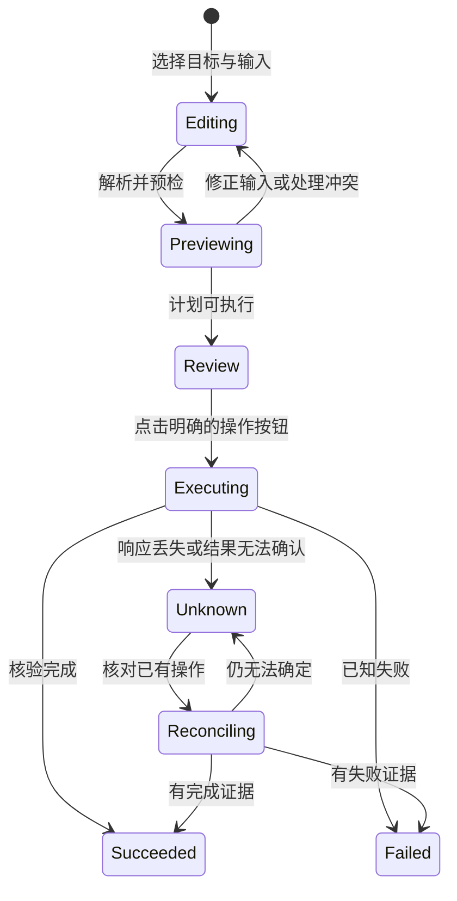
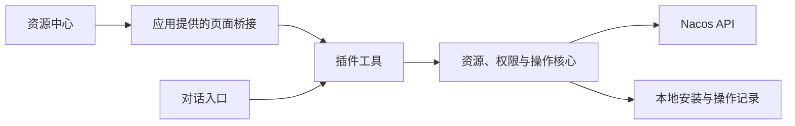

<!--
  Copyright 1999-2026 Alibaba Group Holding Ltd.

  Licensed under the Apache License, Version 2.0 (the "License");
  you may not use this file except in compliance with the License.
  You may obtain a copy of the License at

       http://www.apache.org/licenses/LICENSE-2.0

  Unless required by applicable law or agreed to in writing, software
  distributed under the License is distributed on an "AS IS" BASIS,
  WITHOUT WARRANTIES OR CONDITIONS OF ANY KIND, either express or implied.
  See the License for the specific language governing permissions and
  limitations under the License.
-->

# 资源中心 UI 与交互规范

本文约束 F15，并衔接 F01/F03/F04/F07/F08/F10/F16。采用**简洁工作台**：用户先找到
资源、理解当前状态，再完成一项操作。面向多种 Agent 应用的交互契约在此定义；应用专属
入口、布局参数和工具映射由各适配维护，当前见 [Codex UI 设计](../codex/specs/resource-center-ui-spec.md)。

本文件是后续改版的设计基线，不表示现有页面已经实现。实现与运行验收状态见各适配 TODO。
不因页面改版扩大服务端能力、权限或本期资源范围；未来资源仅在对应适配交付后出现。

## 0. 规范分工与复用边界

当前采用[Codex SVG 图册](../codex/specs/ui-storyboard.md)所表达的单状态交互方案作为设计基线。
可复用部分必须有文字定义，不能要求后续适配通过猜测截图理解行为。

| 层次 | 规范归属 | 跨应用约束与允许差异 |
| --- | --- | --- |
| 资源与业务规则 | 本目录的治理、装配、管理及 Agent 互联规范 | 资源身份、权限、生命周期、计划基线和结果证据一致。 |
| 信息架构与操作 | 本文及[通用操作与状态](resource-center-interaction-spec.md) | 主视图语义、菜单、步骤、确认、返回、异常一致；按应用容器映射布局。 |
| 应用能力与视觉 | `<agent>/specs/resource-center-ui-spec.md` | 分别定义入口、桥接、能力限制、字体、颜色、控件、间距和断点，尽量贴近应用本身。 |
| 图稿与验收 | `<agent>/specs/` 下的图册、TODO 和验证结论 | 图稿展示该应用的一个具体状态；单一适配的结果不构成其他应用支持声明。 |

UIX-01–UIX-14 是稳定的操作索引，供实现、图稿和验收引用，不是路由、工具名或组件 API。
共享规范不要求共享同一份 HTML/CSS、框架或组件库；后续抽取公共状态逻辑时不得包含
应用私有主题值和桥接 API。Codex 的尺寸与配色不能作为 Qoder、WorkBuddy 的默认强制规格。
先验证新应用能力，再在它自己的目录建立映射，不能仅复制 CSS 后宣布已完成适配。

## 1. 体验目标与信息层级

- 日常使用优先：先展示资源名称、用途、状态和一个主要动作；开发、诊断、路径等按需展开。
- 一个工作区处理一个当前操作；搜索列表、详情、操作结果之间保持连续，不反复弹窗跳转。
- 同一状态在页面、工具和对话中的含义一致。文件写入、应用加载、服务可连接、实际使用分别表达。
- 表单只展示当前选择需要填写的字段。默认值必须有依据，配置保存不能冒充连接成功。
- 关键影响用可读字段说明。JSON、协议名和操作 ID 放在诊断详情中，不作为完成任务的必读内容。
- 页面、对话共享资源和操作记录；页面不另建权限、发布或恢复规则。

| 层级 | 展示内容 | 展示位置 |
| --- | --- | --- |
| 第一层：做什么 | 名称、用途、当前状态、主要动作 | 列表与详情首屏 |
| 第二层：影响什么 | 实际版本、目标环境、可见性、安装位置、文件变更 | 接入与发布操作区，确认前可见 |
| 第三层：如何诊断 | 完整路径、端点、凭据变量名、错误码、操作 ID、脱敏响应 | 设置或可展开诊断区 |

完整路径属于安装、上传和卸载的必要目标信息时必须显示；不能以“技术细节”为由隐藏影响范围。

## 2. 信息架构与默认入口

固定三个主视图，辅助工作流单独进入，不把所有能力堆成同一级导航。

| 入口 | 用户问题 | 内容与边界 |
| --- | --- | --- |
| 已接入 | 已经准备了哪些能力，现在处于什么状态？ | 本插件管理的 Skill 安装和服务连接；不把 MCP、Agent 统称为安装包。 |
| 发现资源 | 能找到什么可用能力？ | Client 可见资源搜索、类型筛选、详情与接入。 |
| 我的资源 | 我的远端资源有哪些版本，能否发布？ | 经过服务端身份核验的所有权清单；可维护资源只有契约支持时才有独立筛选。 |
| 本地技能 | 哪些本地 Skill 需要跟踪或上传？ | 从“我的资源”工具栏进入；初始化完成后也能单独重进。 |
| 设置 | 连接、身份与目录如何配置？ | 顶部独立入口；不与扫描清单放在一张长表单中。 |
| 操作记录 | 正在进行或未确定的操作如何核对？ | 顶部入口；有待处理项时显示数量，按当前上下文展示。 |

未配置时显示简短欢迎页及“连接 Nacos”主按钮。已配置、没有接入记录时默认进入发现资源；
有接入记录时默认进入已接入。同一上下文内返回或重新进入可恢复上次视图；没有有效的
页面状态时按上述规则选择。打开页面不自动扫描、上传、执行远端任务或提交空词远端搜索。

顶部持续显示当前连接展示名与 namespace；单中心版本显示连接摘要，不伪装为多中心选择器。
连接状态显示“未检查”“上次检查通过”“连接异常”，带核验时间；不以启动成功显示在线。
项目或个人安装目标只在能够核实的情况下使用友好名称，否则显示已配置目录。

## 3. 工作区、列表与详情

### 3.1 布局规则

宽页面使用工具栏、资源列表与按需展开的详情区；关闭详情后列表恢复完整宽度，不保留空栏。
窄侧栏逐层显示列表、详情、操作，并提供“返回列表”或“返回详情”。返回保留筛选、分页、
滚动位置和选择项，禁止把详情插到列表顶部导致页面突然跳动。

三个主视图使用一致的列表、详情、状态和反馈行为；各应用可使用自己的组件实现。
设置、本地技能和操作记录复用工作区，
带明确标题与返回入口；不使用层叠弹窗承载完整工作流。离开有未保存输入的页面时保留草稿，
或在确实将丢失内容时提示一次；普通浏览切换不弹确认。

### 3.2 资源列表

每一行由类型图标、名称、简短用途、必要元信息、状态及操作区组成。名称可打开详情。
每行最多一个可见主要动作和一个“更多”菜单；核验、刷新、卸载等不平铺成按钮墙。
与行内按钮交互不得同时触发行选择。可点击名称使用真实按钮或链接，支持键盘。

名称至多两行，用途至多两行；完整内容在详情显示。来源/类型可辨认，名称相同的资源按
完整资源引用区分。版本缺失显示“接入前解析”，不猜测版本或以固定默认值代替。
不支持排序、总数或更新检测时，不展示相应控件或“全部最新”状态；只显示已有事实。

搜索分页保留不透明 cursor，不计算伪页码或总页数。使用“加载更多”时追加结果，按资源
引用与版本去重；失败保留已加载项并允许重试该只读页。页码接口使用上一页/下一页与
真实总数。变更搜索条件后重置分页，迟到响应不得覆盖新查询。

### 3.3 详情模板

详情顺序固定为：名称与用途 → 类型/来源/版本/状态 → 资源说明 → 目标与可用动作 → 诊断详情。
基本说明、版本或文件、接入状态按资源能力分组，不为无内容的分组保留空标签。
当前主操作放在稳定的操作区；进入配置或确认步骤后，该区由当前步骤动作接管。

读取权威详情期间显示局部加载，不清空整张列表。摘要、服务端详情和本地接入记录发生
冲突时以新核验结果更新，并说明变化；搜索摘要不能充当授权、版本或端点的最终依据。

### 3.4 菜单、步骤与确认的承载方式

同一时刻只展示当前步骤或结果。设计稿也必须一图一个界面状态，禁止把正常、冲突、成功
等互斥状态排成同一产品页面；流程关系在画面外说明。

| 交互 | 承载方式 | 关闭与后续 |
| --- | --- | --- |
| 行内更多菜单 | 贴近 `⋯` 的浮层，保持列表、选中详情与滚动位置 | 点外部或 Escape 关闭并归还焦点；菜单本身不产生新页面 |
| 更新、安装、接入、版本提交 | 当前详情区的单一步骤；窄屏进入带返回的详情子页 | 返回恢复上一步；成功或冲突替换当前步骤，不并列展示 |
| 卸载、解除接入 | 说明影响的一次确认弹窗，保留背景上下文 | 取消不修改；确认后关闭弹窗，在原工作区反馈结果；执行中禁止重复确认 |
| 本地上传、设置 | 带返回入口的独立子页，内部逐步前进 | 同时只展示预览、编辑、确认或结果中的一种 |

同一时刻只允许一个菜单或模态确认，不叠加“确认后再确认”。危险确认弹窗不能承载整套
接入或更新工作流。空间不足时允许确认内容纵向滚动，不并排压缩多个步骤。
完整入口、按类型菜单、状态转换与返回要求以
[通用操作与状态规范](resource-center-interaction-spec.md)为准；本章是承载形式摘要。

## 4. 已接入

仅展示本插件管理的对象；适配器检测到外部资源时标明“外部管理”，不自动获得修改权限。
同一资源的多个目录、项目或连接记录分别可辨认。默认不为了显示一个计数而触发全量远端核验。

| 资源 | 摘要 | 主要动作 | 次要动作 |
| --- | --- | --- | --- |
| Skill | 已安装版本、安装范围、应用加载状态 | 在对话中使用；未就绪时提供接入说明 | 查看变更、检查文件与访问、更新、卸载 |
| MCP | 连接名称、已验证的连接/工具发现状态 | 已就绪时在对话中使用，否则查看接入说明 | 连接诊断、刷新连接配置、解除接入 |
| 远端 Agent | 已绑定端点的可读摘要、任务状态 | 发起任务 | 查询已知任务、请求取消、更新连接、解除接入 |
| 后续资源类型 | 按装配或绑定记录展示 | 按已交付能力确定 | 不提前显示不可用的占位功能 |

“检查文件与访问”只能证明文件内容和远端读取，不把它称为“验证已能使用”。
“在对话中使用”传入选定资源引用，由当前任务继续核验；无有效当前任务时提供可复制说明。
没有更新检测结果时，使用“检查更新”，不展示猜测的升级版本。

解除接入的确认内容包含名称、位置/连接和实际影响。卸载仅移除归属明确且未被修改的本地
内容，不删除 Nacos 资源，不停止远端服务。冲突直接进入变更说明，不把强制覆盖作为默认出口。

## 5. 发现资源与接入

顶部为可选关键词和提交按钮，类型为次级筛选。首次进入发现视图时，以空关键词读取当前
身份可见资源的第一页；不自动拉取全部分页。按 Enter 或点击搜索提交关键词和类型筛选，
输入过程中不逐字触发远端请求。清空关键词后提交恢复全部可见资源，仍保留所选类型。
服务端只支持名称查询时，提示“搜索资源名称”，不暗示已实现语义推荐。

再次进入同一有效上下文的发现视图恢复已有结果，不重复自动查询；显式刷新或上下文改变后
重新读取。加载更多沿用该列表已提交的筛选和 cursor，不能混用尚未提交的输入。首次查询
失败保留明确重试入口，不自动循环重试。不显示伪造的热门、推荐或最近访问。结果至少展示名称、用途、
类型、来源、版本和当前接入状态。没有匹配项时保留查询并提供清除筛选；查询失败不能显示
成“没有资源”。只开放服务端支持的筛选，Admin 草稿不能混入消费搜索。

快捷接入按钮可直接进入选择步骤，不强迫先点一次“详情”。内部仍按核心契约解析资源。
有且只有一个合法安装目标时可预选，但用户在执行前必须看到确切目标。

确认后的主按钮使用“安装技能”“更新技能”“连接工具”或“接入 Agent”等实际动作；
“生成计划”“执行此计划”仅是内部实现名，不作为常规用户按钮文案。
成功结果留在当前操作区，同时更新对应列表行；由用户选择“查看已接入”或继续浏览，
不强行切换主视图。明确显示已准备好什么，以及应用加载等仍需完成的步骤。

## 6. 我的资源、版本与发布

“我的资源”只表示当前 Nacos 身份所有的远端资源。本机账户、应用账户和本地身份标签
不能作为 owner。服务端能够证明“可维护”时才提供独立筛选，不能与“我所有”混算。
未知身份、不支持的认证方式、无权限、真实空列表分别显示，不退化为扫描全部可见资源。

列表分开表示发布版本和正在编辑/审核的版本；两者可以同时存在，不用一个状态覆盖另一个。
详情展示版本列表、实际可见性及审核结论；编辑、发布动作在选定版本后出现。
“本地技能”作为生产入口；没有远端资源时也可以从此扫描和上传。未启用开发操作时解释
限制并允许返回发现资源，本地设置开关不代表已获得服务端发布权限。

| 当前版本状态 | 交互要求 |
| --- | --- |
| 草稿 | 展示“提交版本”；确认区说明有审核流程则进入审核，没有匹配流程可能直接上线。 |
| 审核中 | 显示进度/最近已知状态与“刷新审核状态”；不出现重复提交按钮。 |
| 审核完成 | 展示实际检查结论；只在核心允许普通发布时启用“发布版本”，不把 reviewed 简化为已批准。 |
| 已发布 | 显示确切版本与可见性；新修改从草稿路径开始，不伪装为在线编辑。 |
| 未知或失败 | 展示可理解原因与核对入口；未经核验不自动重试提交或发布。 |

发布前需要选择版本、确认目标与可见性；确认视图直接承载最终提交，不再套一次通用“确定”弹窗。
PUBLIC/PRIVATE 使用“公开 / 私有”等显示文案，并按 Nacos 的可见性解释，不等同于互联网可访问。

## 7. 本地技能与上传

本地技能采用“选择目录 → 扫描与选择 → 核对文件 → 预检与保存草稿 → 查看结果”的独立流程。
已保存目录只提供勾选，不因进入页面自动扫描。用户可以跳过初始化或返回消费视图，后续继续。

扫描结果使用结构化列表：名称、描述、目录摘要、当前管理方式、可读状态；描述紧邻名称，
完整路径作为次要信息。默认不勾选任何资源。
选中后才出现批量操作条，展示“已选 N 项”；首期批量能力按已实现契约提供，不能用多个
行按钮暗示批量上传已支持。忽略/跟踪不上传，逐项结果包含成功、跳过、失败及原因。

单项上传操作归属资源行，批量操作置于列表之后，完成盘点作为独立次要动作；不混排
单项、批量和流程完成按钮。调整目录后返回原扫描位置，步骤栈不重复堆叠同一返回页面。

上传视图必须在首次传包之前展示接收环境/namespace、文件清单、数量和大小。用户选择
“发送并预检”后才传包；“保存草稿”是预检后的写入动作。文件、目标或身份变化使旧预览失效。
同名绑定或覆盖草稿仅在实际遇到冲突时提供，并显示将绑定/覆盖的对象；默认不勾选。

预检结果不直接堆 JSON：展示新增或更新、目标版本、已有草稿情况、文件变化及下一步。
冲突尚未满足条件时隐藏最终执行动作，保留返回修改选择；不清空原扫描结果和用户输入。
草稿保存后给出实际版本及“查看我的资源”；提交/发布仍是独立动作，不自动串联。
详见[本地托管](local-resource-onboarding-spec.md)与[资源管理](resource-management-spec.md)。

## 8. 设置与初始化

完整问答、页面预填交接与默认目录规则见[初始化规范](onboarding-spec.md)，秘密输入与
存储生命周期见[凭据规范](credential-management-spec.md)。本节只定义设置的页面组织，
具体路径、应用配置格式、工具与视觉值由各适配提供。

设置是独立子页，隐藏“已接入 / 发现资源 / 我的资源”主导航。顶部仅保留返回入口、
“设置”标题与必要的连接摘要，正文使用设置分组导航；不重复展示设置入口和待处理操作。
返回时恢复进入设置前的主视图、搜索筛选、选中资源与滚动位置；设置内部切换分组、
编辑、保存或检查连接不改变这个返回目标。取消编辑仅返回设置摘要，不退出设置。
恢复受第 10 节上下文失效规则约束；配置改变授权范围时重新读取数据，不恢复旧范围的缓存或计划。

首次连接仅收集完成当前用途所需的信息，按“连接 → 身份 → 使用范围”分步。已有配置打开
设置时先展示摘要，点击编辑进入分组表单；日常检查不面对一整页可编辑配置。

| 分组 | 默认内容 | 渐进展开 |
| --- | --- | --- |
| 连接 | 展示名、Client 地址、namespace | Admin 使用独立地址时展开；不从 Console 地址猜测 API 地址。 |
| 身份 | 消费认证方式、凭据提供方式及已配置状态 | 选择页面填写或环境变量；只显示所选方式的字段。管理认证按独立连接需求展开。 |
| 本地目录 | 可辨认的安装目录和扫描目录 | 完整路径及用途；全局页面不把工作目录 `/` 推测为项目目录。 |
| 操作范围 | 搜索读取、安装接入、开发上传、提交发布、服务调用 | 明确这是本机限制；不宣称可以授予服务端权限。 |
| 高级 | 必要时进入 | 稳定连接标识、本地身份标识、应用配置文件及诊断信息。 |

标识只有在核心能稳定生成、保存且不改变既有资源归属时才可自动生成；否则仍提供字段与解释。
改名不能悄悄改变连接身份。技术字段可以逐步展开，但不可丢失必需的定位与认证信息。

摘要与编辑必须共用设置分组布局；默认摘要只含可读名称、地址、命名空间、认证方式和
当前状态。内部连接标识及本地身份标签收进高级区，解释其用途，不当作登录用户名展示。
Client/Admin 使用同一地址与认证时允许共用一组输入；已有独立设置必须保留，显式切换后
才可合并。操作范围以本地化标签展示，底层枚举值不直接作为用户文案。
目录设置与技能盘点各有入口，不在连接摘要按钮组中混入扫描/上传动作。

地址、目录、变量名等在字段旁验证，错误总结可定位首个错误。认证选择切换不把未选方式的
必填校验带入提交。页面填写须使用已验证的受保护通道及本机安全存储，普通配置只含引用，
不能将密码或 Token 放入普通工具参数记录；环境变量路径只填写变量名。
“保存配置”成功后显示“已保存，未检查”；
“检查连接”只声明真正检查的接口，不用消费读取成功推断 Admin 写入授权。

离开未保存表单保留非敏感输入或明确提示；秘密输入在取消、离开或切换认证时清空，
已有凭据只显示已保存状态，不回填密码。从缺少设置的操作跳入设置后，有“返回原操作”入口，
重新生成计划，不复用配置改变前的计划。初始化完成后提供可选本地盘点，不把上传作为必经步骤。

### 8.1 能力发现偏好

设置提供独立“能力发现”分组，展示 [安装策略](capability-discovery-spec.md#32-隐式发现的安装策略)
的 ask/auto/never 三个本地化选项。缺省为“询问是否安装”，明确仅影响解决任务时的发现，
主动要求安装独立处理。“自动”必须描述为有效使用后保存，不暗示发现全部结果即安装。
编辑与保存沿用应用风格；保存只改变偏好，不调用服务、扫描目录或安装资源，也不改变连接身份。
重开读取已保存选择。偏好无需用户再次输入连接凭据，不追溯删除已有资源。

## 9. 操作、反馈与恢复

### 9.1 操作状态

进入确认区时选择、版本和影响必须明确；输入变更撤销旧计划。未执行时“返回”只回到编辑，
已执行后关闭页面不等于取消。没有服务端取消契约的操作不显示“取消执行”。

| 状态 | 页面呈现 | 可继续动作 |
| --- | --- | --- |
| 查询中 | 列表或详情内加载指示，保留已有内容 | 返回或继续浏览；新查询取代旧响应 |
| 执行中 | 操作区显示真实阶段/不确定进度，禁用同一资源的重复写入 | 查看记录，浏览其他已加载资源 |
| 已完成 | 明确动词、资源名、版本与下一步，更新对应行 | 继续浏览、查看已接入/我的资源 |
| 部分完成 | 成功/失败/跳过数量和逐项结果 | 修复失败项；不重放已成功项 |
| 已知失败 | 原因、未完成事项、可采取的下一步 | 仅对可安全重试的动作提供重试 |
| 结果未知 | 持续可见的警示与核对入口 | 查看记录/核对；不提供直接重复提交 |
| 冲突 | 变化对象、旧/新版本或文件差异 | 重新读取并生成计划；不自动覆盖 |

不得为了每次工具调用锁住整个页面。至少允许浏览已有内容与查看执行状态；核心需要串行
执行时，新写操作明确提示等待，不承诺后台并发。离开页面后用操作 ID 恢复已有执行结果，
不重新提交任务。没有完整历史查询能力时，入口准确标为“待处理操作”，不伪装为完整历史。

核心状态按事实维度解释，应用可本地化文案，但不能合并不同成功证据：

| 核心事实 | 通用含义 |
| --- | --- |
| `pending_host_verification` | 文件已安装，等待应用加载确认。 |
| `pending_host_reload` | 连接配置已保存，等待应用刷新。 |
| `configured_unverified` | 已接入，尚未检查连接。 |
| 文件/远端读取验证通过 | 只更新文件与访问维度，不改写应用加载状态。 |
| `completed` 操作 | 按实际动作表达已安装、草稿已保存、已发布等；Agent 任务 completed 只表示任务协议状态。 |
| `result_unknown` | 已发送，结果待核对；保留操作记录入口。 |
| `recovery_required` | 需要恢复本地状态；说明范围，不承诺回滚远端发布。 |
| `reviewed` | 审核已完成，检查结论另行展示，不等同已批准。 |

### 9.2 提示层级与文案

字段错误贴近输入；单项失败贴近资源；连接或桥接中断使用页面级横幅。成功轻提示不移动
内容；未知结果、发布冲突等需要处理的信息不能只出现在自动消失的 toast 中。
关闭详情不显示“已更新”，切换视图不显示“操作成功”。不以颜色或缩写单独表达状态。

错误至少说明“哪一步未完成、原因、下一步”。例如“无法连接资源中心，请检查地址后重试”
或“请求已发送，暂时无法确认草稿是否保存，请先核对结果”。技术错误码进入可展开诊断。
远端 Agent 回复按可读文本展示；任务状态和查询/取消入口紧邻回复，不要求用户读取原始 JSON。

### 9.3 共同组件状态

| 组件 | 必须覆盖的状态或行为 |
| --- | --- |
| 工作区 | 未配置、初始化中、正常、桥接断开；保留有效上下文与导航。 |
| 资源列表/行 | 首次加载、刷新、空结果、失败、选中、权限不足；区分资源与安装记录身份。 |
| 详情 | 读取、显示、编辑、确认、执行、结果；返回栈与焦点恢复。 |
| 操作摘要 | 动作、资源、版本、来源、目标、文件变化及可见性；未知字段明确标注。 |
| 配置字段 | 默认、编辑、校验错误、禁用原因；动态必填与未保存草稿。 |
| 反馈 | 字段/行/页面三级；成功不抢焦点，冲突和未知结果持续可见。 |
| 版本列表 | online/draft/reviewing/reviewed 可并存；选择版本决定允许动作。 |
| 批量栏 | 无选择时隐藏；有选择时显示数量与合法动作，保留逐项结果。 |

## 10. 状态与数据边界

页面持有上下文引用、当前视图、筛选、分页、选择、草稿和正在观察的操作 ID。核心持有
资源授权、安装事实、绑定、计划和操作结果。页面缓存不能授权或证明最新版本。

| 变化 | 必须处理 |
| --- | --- |
| 返回列表 | 恢复同一查询与滚动位置，不重复提交已执行动作 |
| 切换查询 | 重置分页，旧请求仅可被丢弃，不覆盖新查询 |
| 切换连接/namespace/身份 | 清除旧范围数据、选择与待执行计划，重新读取授权上下文 |
| 切换项目/安装作用域 | 重新确认实际目标，不能沿用另一任务的目录 |
| 页面重开或桥接重连 | 读取核心状态；未确定操作先检查记录；表单草稿不等于已保存配置 |
| 权限拒绝或凭据失效 | 标记当前数据不可用，停止后续依赖操作；不换管理员重试 |

应用入口、显示模式、工具桥接与对话发送能力分别协商。全局页面无当前任务时不得创建
会话或向未知会话发送内容。交给 Agent 的仅是用户选定引用、版本、目标和必要摘要，
不自动加入私有文件、整页结果或凭据。外部描述按不可信内容渲染，不加载资源中的脚本。
重复点击防护和旧计划校验仍由核心承担；未知结果核对不保证服务端存在通用幂等键或 CAS。

## 11. 视觉、适配与可访问性

### 11.1 跟随 Agent 应用

“简洁工作台”规定信息优先级和操作连续性，不规定所有插件使用相同灰度、按钮形状或 CSS。
优先跟随所在 Agent 应用的字体、主题、密度和控件语义；应用有自己的强调色时可以沿用，
危险、未知、已完成等状态仍须有文字说明，不能因配色变化改变含义。
不复制应用自己的全局导航，不用大 Logo、渐变头图、装饰统计卡或多层卡片包裹每一组信息。
列表使用留白和分隔组织，当前选择与悬停样式可区分，危险动作仅在对应操作处强调。

主题取值优先级是：应用正式提供且在插件界面可用的主题/组件能力 → 适配层定义的该应用
后备主题 → 无主题信号时的明确默认值。不得读取应用私有 DOM 或猜测未提供的 CSS 变量。
只有应用没有明确主题信号时才考虑系统偏好；应用显式主题优先于系统偏好。
应用无法提供原生控件时，可用自有 CSS 接近其风格，但必须说明是适配设计值。

### 11.2 语义变量与职责

下表规定样式角色，不强制 CSS 变量名称、颜色值或像素值。原生变量只在应用主题适配层
映射一次；业务流程消费这些角色，不直接依赖某应用的私有变量名。

| 样式角色 | 适配须定义 |
| --- | --- |
| 表面 | 页面、次级区域、选中/悬停、浮层和模态遮罩；不能把选中与禁用混淆。 |
| 文字与交互 | 正文、辅助文字、链接、主动作、禁用、焦点环及控件边界。 |
| 状态 | 信息、完成、注意、失败、危险动作；与业务状态分别映射，不能只用颜色表达。 |
| 排版 | 系统/应用字体、字阶、行高、字重、长名称和完整路径的换行。 |
| 空间与形状 | 间距、控件高度、触达区域、圆角、分隔、浮层阴影和列表密度。 |
| 容器与动效 | 详情并排的最小空间、单列回退、浮层避让、减少动态效果和滚动策略。 |

样式层负责“长什么样”，应用能力适配负责“能否打开页面、交接对话、读取主题”，
操作层负责“点击后发生什么”。更换主题、断点或组件库不得触发重新搜索、重复执行、
重置表单、修改授权或更换返回来源。流程可复用不等于当前已建立通用前端库。

### 11.3 新应用的适配记录

应用适配须给出明确的间距、字阶、控件尺寸、色彩语义、断点和浅/深色方案。设计数值与
服务端状态分开维护；不能依赖颜色判断权限或执行结果。具体 Codex 参数见其专属规范。
每个适配还必须记录下列内容；未知能力标为待验证。

| 记录项 | 需要说明 |
| --- | --- |
| 入口与能力 | 实际应用版本、页面/侧栏、桥接、主题信号、消息和剪贴板分别是否支持。 |
| 操作映射 | UIX-01–UIX-14 对应入口、工具、限制与替代路径；不支持的动作不伪造。 |
| 呈现映射 | 列表/详情、更多浮层、确认层、设置子页分别采用何种原生或自有组件。 |
| 主题来源 | 经过验证的变量或组件入口、缺失值后备、浅深色及高对比模式的处理。 |
| 适配差异 | 哪些只是 CSS/控件差异，哪些因真实能力限制而受限；记录原因和验收项。 |
| 验收证据 | 通用行为与该应用视觉分别验证；复用代码或图稿不能替代实际入口验收。 |

允许依照应用习惯调整控件外观和分组位置，但不能把更多菜单改成整页、把步骤拼成多块、
在设置恢复三主导航，或用样式掩盖真实状态。确有能力限制时记录受限路径，不默默改变契约。

### 11.4 可访问性

键盘可完成搜索、选资源、打开详情、确认与返回。关闭详情后焦点回到原触发项；菜单和
对话框管理焦点与 Escape，不误触发后台按钮。动作执行中和完成后用适度的状态播报，
不反复播报整个页面。字段有可见标签，图标按钮有名称，禁用原因在悬停以外也可获得。

项目验收目标：正文/辅助文字对比度至少 4.5:1，大字和控件边界/焦点至少 3:1；200% 缩放
可读，320 CSS px 宽无页面级横向滚动。减少动态效果时关闭非必要过渡，错误和忙碌反馈
不依赖动画。它们是本项目检查要求，不据此宣称取得完整可访问性认证。

## 12. 通用验收清单

| 编号 | 场景 | 可观察的完成条件 |
| --- | --- | --- |
| U01 | 进入与继续 | 未配置、无接入、已有资源分别进入正确首屏；可跳过盘点并继续消费。 |
| U02 | 搜索 | Enter、筛选、分页、无结果与请求失败可区分；迟到响应不覆盖新查询。 |
| U03 | 接入 | 从搜索到确认再到结果，名称/来源/版本/目标一致；列表只显示真实接入与加载状态。 |
| U04 | 资源管理 | 我的资源不混入共享项；多版本状态独立，发布前可见实际影响。 |
| U05 | 本地技能 | 扫描不上传；跟踪/忽略/预检/草稿/发布分开；逐项结果可读。 |
| U06 | 配置 | 按认证选择展示字段；消费者无需填写管理凭据；保存与诊断状态分离；设置内部切换不覆盖返回来源。 |
| U07 | 连续操作 | 返回不丢查询和选中项；成功不强制换视图；离开未保存表单不会悄悄丢失输入。 |
| U08 | 异常与恢复 | 冲突、部分失败和未知结果有持续可见的下一步；不重复执行写入。 |
| U09 | 上下文一致 | 页面与对话看到相同结果；身份/项目变更使旧选择与计划失效。 |
| U10 | 适配与可访问性 | 宽窄、浅深色、长文本、键盘、缩放均可完成主要路径，无遮挡和不可达动作。 |
| U11 | 原生应用验收 | 在目标应用真实入口中打开、调用、关闭重开；本地浏览器或截图不替代该项。 |
| U12 | 范围准确 | 未支持类型、排序、总数、历史、授权与应用能力不虚构；无页面时保留工具路径。 |
| U13 | 菜单与步骤 | 更多是原行浮层；关闭恢复焦点；操作、条件冲突与结果逐步替换；危险动作一次确认，取消不修改。 |
| U14 | 设置子页 | 摘要、编辑、保存、检查均无三主导航；取消编辑回摘要，返回恢复有效来源；上下文变化不恢复旧数据。 |
| U15 | 应用风格与语义 | 主题和容器变化只改变呈现；依照本应用风格完成同一 UIX 路径，不重提写入、丢输入或改变返回目标。 |

具体执行记录保存在测试环境本地；仓库只保留验收结论、适用范围和待办。
